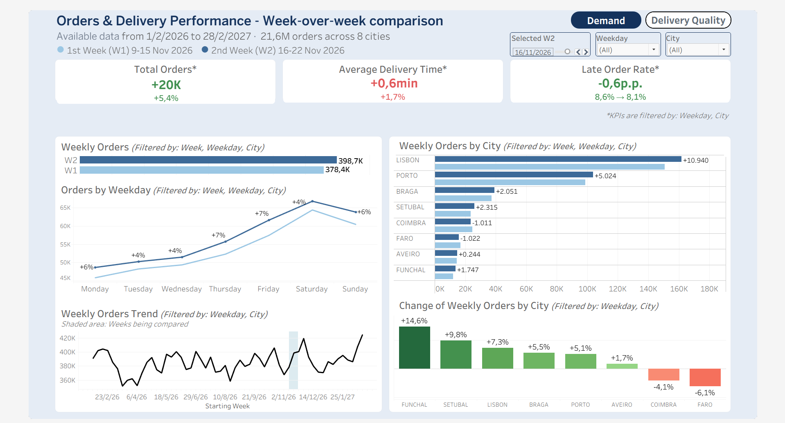

# Week-over-Week Analysis | Interactive Tableau Dashboard

## Project Overview

This project presents an interactive Tableau dashboard designed to analyze week-over-week (WoW) changes in order demand and delivery performance across 8 cities.

The analysis is based on a synthetic dataset containing 13 months of daily order data.

Users can select any week to compare with the previous one and explore key performance metrics by city or weekday.

## Live Dashboard

🔗 **[Explore the interactive dashboard on Tableau Public] https://public.tableau.com/views/WoWOrdersAnalysisInteractiveDashboard/Demand?:language=en-US&:sid=&:redirect=auth&:display_count=n&:origin=viz_share_link**

**Viewing tip:** Use the scrollbars to locate the Full Screen button in the bottom-right corner. Then adjust your browser's zoom level (Ctrl + / Ctrl -) to fit the dashboard to your screen.

## Dataset

The synthetic dataset includes the following fields:

- **City:** City where orders were placed
- **Day:** Order date
- **Week Number:** Week identifier
- **Orders Count:** Number of orders
- **Average Delivery Time (minutes):** Average delivery duration
- **Late Orders Percentage:** Percentage of late deliveries

## Key Metrics

The dashboard focuses on three main areas:

**1. Order Demand**
- Total orders per week
- Week-over-week percentage change in orders
- Demand trends by city and weekday

**2. Delivery Time**
- Average delivery time
- Week-over-week changes in delivery time
- Delivery time comparisons by city and weekday

**3. Late Deliveries**
- Late order rate
- Week-over-week changes in late order rate
- Late delivery comparisons by city and weekday

## Dashboard Features

- Dynamic week selection for WoW comparisons
- Interactive KPI cards
- City and weekday filters
- Parameters and calculated fields
- Dashboard actions and interactive visualizations
- Order-weighted calculations for average delivery time and late order rate
- Dynamic comparisons across different time periods

## Dashboard Screenshots

### 1. Demand Analysis

Explore week-over-week changes in order volume and identify demand patterns across cities and weekdays.

### 2. Delivery Time by City

Compare average delivery times across cities and identify changes in delivery performance between consecutive weeks.

### 3. Delivery Time by Weekday

Analyze delivery time patterns throughout the week and compare performance between consecutive weeks.

### 4. Late Orders by City

Examine late order rates across cities and identify week-over-week changes in delivery reliability.

### 5. Late Orders by Weekday

Explore late delivery patterns by weekday and compare late order rates between consecutive weeks.

## Tools & Skills

**Tools:**
- Tableau Desktop
- Tableau Public

**Technical Skills:**
- Calculated Fields
- Parameters
- Dashboard Actions
- Interactive Filters
- Weighted Aggregations
- Week-over-Week Analysis
- Data Visualization
- KPI Development

## Project Purpose

The goal of this project was to develop a flexible, interactive BI dashboard that enables users to monitor changes in order demand and delivery performance.

By combining dynamic week selection, interactive filters, and multiple analytical views, the dashboard allows users to identify trends, compare city-level performance, and explore potential areas for operational improvement.

*This project was developed using synthetic data for portfolio and educational purposes.*
